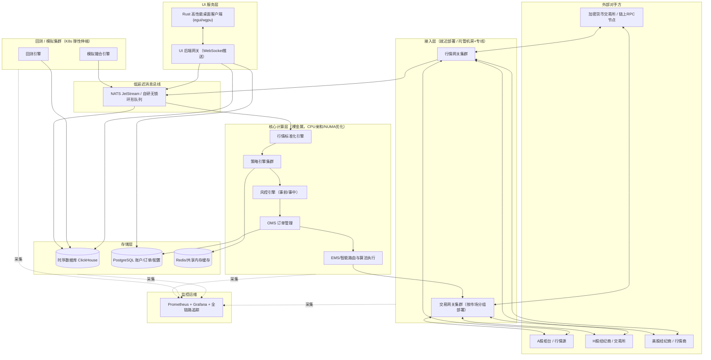

# Apexes — 最终目标与总体设计（North Star）

> 项目原名 Talon，已更名为 **Apexes**。本文档是项目的顶层锚点：先给出最终目标，再给出系统总体设计（沿用最初的架构方案），最后给出子项目拆解路线图。每个子项目在正式开发前都会单独走一轮 brainstorming → spec → plan → implementation 流程；本文档不替代那些子 spec，只作为它们的上位索引与一致性依据。

---

## 一、最终目标（Final Objective）

**Apexes 是一个用于执行真实资金交易的多市场自动化交易系统**，而不是一个纯学术或纯基础设施项目。它的存在目的是：

1. **在多个真实市场上代表用户执行真实交易**：
   - 加密货币：Binance 等主流 CEX，以及 DEX
   - 中国 A 股市场（上交所 SSE / 深交所 SZSE）
   - 香港 H 股市场（港交所 HKEX）
   - 美股市场（NASDAQ / NYSE）
2. **在现有策略或用户自定义策略下，尽可能多赚、尽可能少亏**，具体依赖：
   - Apexes 内置/标准策略
   - 用户通过 Apexes 策略 SDK 自定义与调优的策略/风控策略
3. **足够安全可靠，可以托管真实资金**——这正是原始设计中的各项原则（低延迟、回测/模拟/实盘逻辑同源、风控、高可用、安全合规）不是锦上添花而是硬性要求的原因：这是真实市场中的真实资金，且伴随真实的监管暴露（A股穿透式监管、港美股经纪商合规要求）。

**关键推论**：由于终态是"真实资金的真实交易"，以下模块的正确性不是"重要模块"而是"系统能否被信任无人值守运行"的决定性因素，在任何子项目阶段都不允许为了赶进度而降低质量标准：
- 风控引擎（事前/事中风控）
- OMS 订单生命周期状态机与断线重连对账
- 回测/模拟/实盘的逻辑同源性（同一套 trait 定义，避免"回测赚钱、实盘亏钱"的逻辑漂移）

---

## 二、系统总体设计

### 2.1 设计原则

1. **低延迟优先**：核心链路（行情→策略→风控→下单）全内存、无锁、零拷贝，避免 GC 抖动（Rust 天然优势）。
2. **回测/模拟/实盘同源代码**：策略逻辑、撮合接口、风控规则三套环境共用同一 trait 定义，避免"回测赚钱、实盘亏钱"的逻辑漂移。
3. **多市场统一抽象 + 差异化适配**：用统一的 `Instrument / Order / Fill` 模型屏蔽 CEX、A股柜台、港美股经纪商的协议差异，具体协议差异下沉到网关适配层。
4. **免费优先、付费可插拔**：所有外部数据源/交易通道均定义为可替换的 Provider trait，默认接免费源，付费源按配置切换，互不侵入核心逻辑。
5. **高可用**：核心链路多活部署 + 状态复制，故障秒级切换；数据链路允许降级但不允许静默丢单。

### 2.2 系统功能清单

1. **行情与数据接入层**：加密货币（CEX/DEX/链上/Mempool）、A股（免费源 + Level-2 付费）、H股（富途/长桥 + HKEX OMD-C）、美股（IEX/Alpaca/Polygon 免费层 + Polygon付费/Databento/Nasdaq TotalView）、行情标准化引擎、历史数据存储回补、行情分发总线。
2. **策略与算法研究平台**：Rust 原生策略 SDK（含 PyO3 绑定）、因子库/技术指标库、多信号组合与仓位生成、参数优化接口、策略版本管理与灰度发布。
3. **回测系统**：Tick级精确重放、撮合模拟器（订单簿重建/概率成交/深度消耗）、成本模型（滑点/手续费/冲击成本/资金费率）、绩效归因与风险指标、回测报告可视化。
4. **模拟交易系统（Paper Trading）**：虚拟账户、复用回测撮合内核的实时模拟撮合、与实盘一致的订单生命周期状态机。
5. **实盘交易系统**：OMS（订单生成/状态机/持久化对账）、EMS（智能路由 SOR、TWAP/VWAP/冰山/POV、跨市场拆单）、分市场交易网关（加密货币、A股柜台 CTP/QMT/O32/XTP、H股/美股经纪商 IBKR/富途/长桥）、可选 FIX 协议引擎。
6. **风险管理系统**：事前风控（限额/黑白名单/自成交防范）、事中风控（实时仓位监控/熔断）、事后风控与合规报表、保证金杠杆监控、极端行情熔断与策略自动降级。
7. **账户与资金管理**：多市场多账户统一管理、资金划转结算对账、实时持仓与盈亏（含汇率折算）。
8. **数据存储与消息中间件**：ClickHouse/QuestDB（时序）、PostgreSQL（关系型）、NATS JetStream 或自研无锁环形队列（消息总线）、Redis/共享内存缓存。
9. **高性能 UI 模块**：实时行情看板、GPU 渲染 K线/Tick 图表引擎（wgpu）、策略监控调参面板、订单持仓风控管理界面、回测报告可视化、多屏系统监控大屏。
10. **系统监控与运维**：分布式日志与全链路追踪（tracing + OpenTelemetry）、Prometheus + Grafana 告警、高可用灾备（多活/Raft/秒级切换）、灰度发布与一键回滚。
11. **安全与合规**：密钥/私钥管理（KMS/HSM，重点保护链上钱包私钥）、RBAC 权限与操作审计、网络安全（专线/VPN/DDoS/双向TLS）、监管合规（A股穿透式监管报送、境外市场合规要求）。

### 2.3 系统逻辑部署图

**部署要点**：
- 行情/交易网关就近部署在交易所机柜或云端可用区，与交易所延迟最小化；A股/H股/美股网关按监管要求可能需独立托管环境。
- 核心计算层（策略/风控/OMS/EMS）单独部署于低延迟裸金属集群，与网关之间用专线或同机房内网通信。
- 回测/模拟集群资源需求波动大，用 K8s 弹性伸缩，与实盘集群物理隔离，避免资源抢占影响实盘延迟。
- UI 服务层与核心计算层解耦，通过消息总线异步订阅，避免 UI 渲染压力回灌交易链路。

### 2.4 技术选型

| 层面 | 选型 |
|---|---|
| 语言/运行时 | Rust + Tokio（异步核心链路用 `tokio` 或裸线程+无锁队列） |
| 消息总线 | NATS JetStream（灵活）或自研 SPSC/MPSC 无锁环形队列（极致延迟） |
| 时序存储 | ClickHouse（Tick级海量数据，列存高压缩） |
| 关系存储 | PostgreSQL |
| 缓存 | Redis 或进程内共享内存（`memmap2`） |
| UI 框架 | `egui` + `wgpu`（跨平台原生高性能渲染），或 Tauri + WebGPU 前端 |
| 序列化 | `rkyv` / `bincode`（零拷贝，替代 JSON 用于核心链路） |
| 监控 | Prometheus + Grafana + `tracing`/OpenTelemetry |
| 容器编排 | Kubernetes（回测/模拟/UI服务）+ 裸金属（核心交易链路） |

### 2.5 数据源接入策略（免费优先、付费可插拔）

| 市场 | 免费方案 | 付费方案（可选） |
|---|---|---|
| 加密货币 | 各交易所公开 REST/WS、Infura/Alchemy 免费层 RPC | 交易所机构专线、QuickNode/自建全节点 |
| A股 | AKShare/Tushare/新浪财经 | 恒生UF2.0/中泰XTP/华鑫奇点 Level-2 |
| H股 | 富途/长桥 OpenAPI | 港交所 OMD-C 直连 |
| 美股 | IEX Cloud/Alpaca/Polygon 免费层 | Polygon.io 付费版/Databento/Nasdaq TotalView |

所有数据源均实现统一 `MarketDataProvider` trait，配置文件切换即可替换，核心策略/风控代码零改动。

### 2.6 开源库复用策略

Apexes 优先复用成熟开源库，而非从零造轮子，但**核心类型（`Instrument`/`Order`/`Fill`/`MarketEvent`）必须保持多市场通用**，不能被单一市场（尤其加密货币）的外部库假设绑架。据此确定以下复用边界：

- **`apexes-core` 保持自研**：`Instrument`/`Market`/`Order`/`OrderStatus`/`Fill`/`MarketEvent`/`MarketDataProvider` trait 均在 `apexes-core` 中自定义，全部使用 `rust_decimal::Decimal`、覆盖 A股/H股/美股/加密货币四类市场——这是保证"多市场统一抽象"设计原则（§2.1 第3条）不被破坏的前提。
- **`barter-rs` 生态（`barter-data` / `barter-execution` / `barter-instrument`）作为加密货币网关的底层连接器**：调研发现 `barter-instrument::ExchangeId` 是不可扩展的封闭枚举，仅覆盖约40家加密货币交易所（BinanceSpot、Okx、Bitfinex 等），完全不包含 A股/H股/美股概念；且 `barter-data` 内部价格字段存在 `f64`（`PublicTrade`/`Candle`）与 `Decimal`（`OrderBookL1`）混用的精度不一致问题。因此**不直接采用 barter-rs 的类型作为 `apexes-core` 的核心类型**，而是在子项目 #1（行情接入）与 #8（首个实盘网关）中，将 `barter-data`/`barter-execution` 作为 Binance/OKX 等交易所 WebSocket/REST 协议细节的底层实现，在网关适配层内部完成 barter 类型 ↔ Apexes 类型的转换，避免从零手写交易所协议代码。
- **其他候选库**（子项目 #10 及之后按需评估）：`binance-sdk`（Binance 官方 Rust connector）、`ibkr_client_polrtal`/`ibkr-cp-api-client`（IBKR Client Portal API）等，逐一在对应子项目设计阶段单独评估，遵循同样的"底层连接器可借用、核心抽象不外包"原则。
- **通用基础库直接依赖**：`rust_decimal`、`serde`、`thiserror`、`chrono`、`tokio`、`futures` 等无市场特定假设的基础库，直接作为 `apexes-core` 及各子项目的依赖，无需自研替代。

### 2.7 高可用、性能与安全要点

- **性能**：核心链路全程无锁队列 + 内存池，避免动态分配；CPU 核心绑定 + NUMA 感知；零拷贝序列化；PTP 时钟同步；视延迟要求可选配 DPDK/内核旁路。
- **高可用**：核心服务多活部署，状态通过 Raft 复制，主节点故障秒级切换；订单状态强持久化，重启后基于交易所回报强制对账，杜绝"幽灵仓位"；消息总线支持重放；全链路健康检查+熔断降级。
- **安全合规**：私钥/API Key 统一由 KMS/HSM 管理，业务代码不落地明文密钥；全操作审计日志不可篡改；分市场满足对应监管报送要求。

---

## 三、子项目拆解路线图（Roadmap）

> 完整设计范围过大，无法一次性 spec 完成。以下路线图将其拆解为按顺序推进的子项目；每个子项目在真正开始设计前，都会单独走一次 brainstorming → spec → plan → implementation 流程。**排序依据**：优先跑通"数据→回测→模拟→实盘"的完整垂直切片，且优先选择集成成本最低的市场（加密货币：公开 API、无需券商开户）打通全链路后，再横向扩展到 A股/H股/美股（CTP/XTP 开户、IBKR 入驻、合规成本高得多）。UI 有意后置——等真实数据流跑起来后再引入更有意义。
>
> **2026-07-28 更新**：子项目 #2（历史数据存储）brainstorming 阶段中，重新评估了"本地文件优先、ClickHouse 后置"的原定排序。本地 Parquet 方案在设计增量写入语义时遇到真实的格式限制（Parquet 是一次性写入、footer 终结的格式，不支持对已关闭文件追加 row group），且 `clickhouse` Rust 客户端已经成熟稳定（官方维护、1000万+下载量）。综合考虑后决定：**将 ClickHouse 引入的时间点从子项目 #12 提前到子项目 #2**，用 ClickHouse 作为历史数据存储的唯一后端，不再经过"本地文件→ClickHouse"的中间迁移阶段。子项目 #12 相应改为"消息总线"（不再包含存储层）。

| # | 子项目 | Crate（预估） | 依赖 | 一句话目标 |
|---|---|---|---|---|
| 0 | 基础骨架（Foundation skeleton） | `apexes-core`, `apexes-cli` | — | 共享类型/trait：Instrument、Order、Fill、MarketDataProvider、ApexesError |
| 1 | 行情接入（单一免费加密货币源） | `apexes-market-data` | 0 | 一个真实的 `MarketDataProvider` 实现（如 Binance 公开 WS，底层可复用 `barter-data`），验证 trait 端到端可用 |
| 2 | 历史数据存储（ClickHouse） | `apexes-storage` | 0, 1 | 用 ClickHouse 持久化 tick/bar 数据，作为唯一存储后端（原计划的"本地文件优先"已于 2026-07-28 调整，见上方更新说明） |
| 3 | 回测引擎 | `apexes-backtest` | 0, 2 | Tick 重放 + 撮合模拟器 + 成本模型 |
| 4 | 策略 SDK | `apexes-strategy` | 0 | Rust trait 策略 API，可在回测中运行 |
| 5 | 风控引擎（事前风控） | `apexes-risk` | 0 | 限额检查、黑白名单、自成交防范——回测/模拟/实盘共用 |
| 6 | 模拟交易（Paper Trading） | `apexes-paper` | 1, 3, 4, 5 | 实时行情 + 复用回测撮合内核，与实盘一致的 OrderStatus 生命周期 |
| 7 | OMS | `apexes-oms` | 0, 5 | 真实订单生命周期、持久化、断线重连对账 |
| 8 | 首个实盘网关（加密货币 CEX） | `apexes-gateway-crypto` | 0, 7 | 在一个交易所真实下单（底层可复用 `barter-execution`），打通回测→模拟→实盘闭环 |
| 9 | EMS / 执行算法 | `apexes-ems` | 7, 8 | TWAP/VWAP/冰山、智能路由 |
| 10 | 其他市场网关 | `apexes-gateway-ashare`, `-hshare`, `-usequity` | 7, 8 | 加密货币路径验证后，扩展到 A股/H股/美股 |
| 11 | 账户与资金管理 | `apexes-account` | 7 | 多市场持仓、盈亏、汇率折算 |
| 12 | 消息总线 | 基础设施，非独立 crate | 1–8 | 达到规模瓶颈后引入 NATS JetStream（存储层已于 #2 提前完成，不再包含在本子项目） |
| 13 | UI | `apexes-ui` | 1, 7, 8 | egui/wgpu 仪表盘，通过消息总线订阅 |
| 14 | 监控运维 | 横切关注点 | 持续 | tracing/OTel、Prometheus、高可用/故障切换 |
| 15 | 安全与合规 | 横切关注点 | 持续 | KMS/HSM、RBAC、审计日志、监管报送 |

**当前所处阶段**：子项目 #0、#1 已完成；子项目 #2（历史数据存储，ClickHouse）设计中。

---

## 四、文档维护约定

- 本文件是"顶层索引"，不记录子项目的实现细节；子项目的详细 spec 单独存放于 `docs/superpowers/specs/YYYY-MM-DD-apexes-<subproject>-design.md`。
- 若路线图顺序或范围发生调整，需回到本文件更新，保持它与实际开发顺序一致。
- 项目原名 Talon 的所有历史提法在本文档及后续文档中一律使用 **Apexes**。
