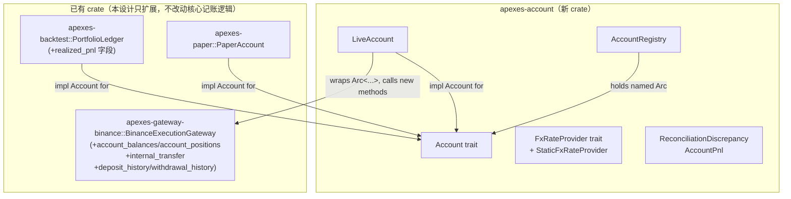

# Apexes — 子项目 #11：账户与资金管理（`docs/FEATURES.md` 行 `7.1`/`7.2`/`7.3`）设计

> 本文档是路线图子项目 `#11`（账户与资金管理）的详细设计，覆盖 `docs/FEATURES.md` 行 `7.1`（多市场多账户统一管理）、`7.2`（资金划转、结算与对账）、`7.3`（实时持仓与盈亏，含汇率折算）。
>
> **前置依赖（已完成）**：仅依赖子项目 `#7`（`apexes-oms`）。本设计额外复用（但不是强制依赖顺序上的前置）`apexes-backtest::PortfolioLedger`、`apexes-paper::PaperAccount`、`apexes-gateway-binance::BinanceExecutionGateway`（子项目 #3/#6/#8，均已完成）。

---

## 一、范围

### 背景与关键决策

当前系统里只有**一个**真实市场/网关集成（Binance 加密货币现货 + USDS-M 永续合约，经 `apexes-gateway-binance`）；A股/H股/美股网关（子项目 `#10`）尚未开始。因此本设计遵循本项目一贯的"为 trait 而设计，不为单一供应商设计"原则：

- **账户抽象现在就做成跨市场/跨账户的**（`Account` trait、`AccountRegistry`），但**只对接一个真实网关**（Binance）；A股/H股/美股场景只能通过 mock/测试验证接口形状，不实现真实网关。
- **统一 backtest/paper/live 三种环境**：`PortfolioLedger`（backtest）、`PaperAccount`（paper）、新的 `LiveAccount`（live，包装真实 Binance API）都实现同一个 `Account` trait——延续本项目"回测/模拟/实盘逻辑同源"的核心设计原则。

### 包含

1. **`apexes-account`（新 crate）**：
   - `Account` trait（异步）：统一的余额/持仓/权益/资金历史/划转/对账接口。
   - `AccountRegistry`：持有多个命名 `Arc<dyn Account>`，支持按名字查询单个账户及跨账户聚合查询（如总权益）。
   - `FxRateProvider` trait + `StaticFxRateProvider`（配置化静态汇率表）：为 `equity()` 提供跨币种统一计价的汇率转换，仿照 `MarkPriceProvider` 的 trait 设计模式。
   - `LiveAccount`：包装 `Arc<BinanceExecutionGateway>`，实现 `Account` trait，调用下方新增的真实 API。
   - `ReconciliationDiscrepancy`：对账发现不一致时的告警数据结构（不自动修正本地状态）。
2. **`PortfolioLedger` 扩展**（`apexes-backtest`）：
   - 新增 `realized_pnl: HashMap<String, Decimal>` 字段，按 symbol 累加已实现盈亏——覆盖杠杆仓位的平仓路径（已有计算逻辑，现在额外累加而非仅体现在 balance 变化里）和现货仓位的减仓路径（新增 `(卖出价/买入价 - average_entry_price) * 成交数量` 的计算，按方向取正确符号）。
   - 实现 `apexes-account::Account` trait（`impl Account for PortfolioLedger`，`apexes-account` 依赖 `apexes-backtest` 而非反向依赖，避免循环依赖——见架构图）。
3. **`PaperAccount` 扩展**（`apexes-paper`）：实现 `Account` trait（包装它已持有的 `&PortfolioLedger` 引用，与现有 `balances_snapshot`/`positions_snapshot`/`equity_snapshot` 委托模式一致）。
4. **`apexes-gateway-binance` 新增真实 API 方法**（不修改现有 `ExecutionGateway` trait，作为 `BinanceExecutionGateway` 的额外公开方法，供 `apexes-account::LiveAccount` 直接调用）：
   - `account_balances()`：查询真实 Spot + USDS-M 期货余额。
   - `account_positions()`：查询真实 USDS-M 期货持仓。
   - `internal_transfer(from_wallet, to_wallet, asset, amount)`：真实钱包间划转（如 Spot ↔ USDS-M Futures），调用币安真实划转 API（`POST /sapi/v1/asset/transfer`）。
   - `deposit_history()` / `withdrawal_history()`：只读查询充值/提现历史（`GET /sapi/v1/capital/deposit/hisrec` / `GET /sapi/v1/capital/withdraw/history`）。
5. **对账机制**：`Account::reconcile_against_exchange()`——拉取真实余额/持仓（`account_balances`/`account_positions`），与本地计算值比较，超出可配置容差（绝对值或相对百分比阈值，由调用方配置传入，不硬编码）则返回 `Vec<ReconciliationDiscrepancy>`；**不自动修正本地状态**，只记录/告警（呼应本项目"从不用交易所数据静默覆盖本地状态"的一贯原则，与保证金/极端行情模块的既有设计保持一致）。
6. **P&L 计算**：`AccountPnl`——调用 `equity(&fx_provider)` 得到跨币种统一计价的总权益；已实现盈亏直接读取 `realized_pnl` 字段汇总；未实现盈亏按当前持仓逐一计算（`(mark_price - average_entry_price) * quantity`，结合杠杆/`margin_mode` 已有逻辑）。

### 不包含（明确超出范围）

- **真实提现发起**：只做充值/提现历史只读查询，不实现主动发起提现的 API 调用——提现操作留给人工/交易所官方 UI，本子项目只负责对账。
- **A股/H股/美股真实网关对接**（子项目 `#10`，未开始）——`Account` trait 的抽象设计允许未来接入，但本设计不实现任何非 Binance 的真实网关。
- **资金层面的自动交易/再平衡策略**（如自动跨钱包再平衡触发器）——本设计只提供"手动调用一次划转"的能力，不做自动化决策。
- **实时汇率数据源**（如接入真实外汇行情 API）——`FxRateProvider` 只提供一个静态/配置化实现；真实 FX 数据流是未来的独立后续工作。
- **保证金/杠杆监控（行 `6.4`）与极端行情熔断（行 `6.5`）的重复实现**——这两者已在子项目 `#5` 完成，本设计只复用其既有的 `Position.allocated_margin`/`margin_mode`/`leverage` 字段，不重新设计保证金逻辑。
- **账户历史持久化/审计报表**（行 `6.3`，归属子项目 `#15`）——`reconcile_against_exchange()` 的告警只通过 `tracing` 记录，不落库存档。

---

## 二、架构与依赖关系



**依赖方向**：`apexes-account` 依赖 `apexes-core`、`apexes-strategy`（`Position`）、`apexes-backtest`（为 `PortfolioLedger` 实现 trait）、`apexes-paper`（为 `PaperAccount` 实现 trait）、`apexes-gateway-binance`（`LiveAccount` 包装真实网关）。反向：这四个 crate 均不依赖 `apexes-account`，避免循环依赖——与 `apexes-risk`/`apexes-oms` 现有的"上层 crate 依赖下层，下层从不感知上层"模式一致。

---

## 三、核心类型设计

### 3.1 `Account` trait（`apexes-account`，新文件 `account.rs`）

```rust
#[async_trait]
pub trait Account: Send + Sync {
    /// 账户内每个资产的余额快照（资产符号 -> 数量）。
    fn balances(&self) -> HashMap<String, Decimal>;

    /// 账户内每个 symbol 的当前净持仓快照。
    fn positions(&self) -> HashMap<String, Position>;

    /// 已实现盈亏，按 symbol 拆分。
    fn realized_pnl(&self) -> HashMap<String, Decimal>;

    /// 用 `fx_provider` 把所有余额折算为 `valuation_currency` 计价后求和，
    /// 得到跨币种统一计价的总权益。`mark_prices` 用法与
    /// `PortfolioLedger::equity` 一致（资产符号 -> 计价货币单价）。
    fn equity(
        &self,
        mark_prices: &HashMap<String, Decimal>,
        fx_provider: &dyn FxRateProvider,
        valuation_currency: &str,
    ) -> Result<Decimal, ApexesError>;

    /// 充值历史（只读）。
    async fn deposit_history(&self) -> Result<Vec<FundMovement>, ApexesError>;

    /// 提现历史（只读，本设计不支持主动发起提现）。
    async fn withdrawal_history(&self) -> Result<Vec<FundMovement>, ApexesError>;

    /// 同一账户内钱包间划转（如 Binance Spot <-> USDS-M Futures）。
    /// backtest/paper 环境：无真实钱包概念，返回
    /// `ApexesError::UnsupportedForEnvironment`（不 panic，调用方需要
    /// 显式处理"这个账户不支持划转"的情况）。
    async fn internal_transfer(
        &self,
        from_wallet: WalletId,
        to_wallet: WalletId,
        asset: &str,
        amount: Decimal,
    ) -> Result<(), ApexesError>;

    /// 拉取交易所真实余额/持仓，与本地状态比较，返回超出 `tolerance`
    /// 的不一致项；不修改任何本地状态。backtest/paper 环境：没有
    /// "真实交易所"可对比，返回空 `Vec`（不是错误——对账在这些环境下
    /// 天然是平凡通过的，因为本地状态就是唯一真相来源）。
    async fn reconcile_against_exchange(
        &self,
        tolerance: ReconciliationTolerance,
    ) -> Result<Vec<ReconciliationDiscrepancy>, ApexesError>;
}
```

`balances`/`positions`/`realized_pnl`/`equity` 是同步方法（`PortfolioLedger`/`PaperAccount` 的等价方法本身就是同步的，`LiveAccount` 对这几个方法内部维护一份本地缓存视图，与 `deposit_history`/`internal_transfer`/`reconcile_against_exchange` 等需要真实网络请求的方法区分开——这是刻意的设计，见 3.5 节 `LiveAccount` 的缓存策略）。

### 3.2 `WalletId`、`FundMovement`、`ReconciliationTolerance`、`ReconciliationDiscrepancy`

> **定义位置提前说明**：`WalletId`/`FundMovement`/`FundMovementStatus` 实际定义在 `apexes-core`（原因见第四节的循环依赖分析），`apexes-account` 通过 `pub use apexes_core::{WalletId, FundMovement, FundMovementStatus};` 重导出。`ReconciliationTolerance`/`ReconciliationDiscrepancy` 只被 `apexes-account::Account` trait 使用，没有循环依赖问题，直接定义在 `apexes-account`。以下类型定义按最终归属位置列出：

```rust
// crates/apexes-core/src/account.rs（新文件，与 order.rs/fill.rs 同级）

/// 交易所内部的资金账户类别。backtest/paper 环境不使用此类型
/// （`internal_transfer` 直接返回 `UnsupportedForEnvironment`）。
#[derive(Debug, Clone, Copy, PartialEq, Eq, Hash, Serialize, Deserialize)]
pub enum WalletId {
    Spot,
    UsdsFutures,
}

/// 一笔充值或提现记录。
#[derive(Debug, Clone, PartialEq)]
pub struct FundMovement {
    pub asset: String,
    pub amount: Decimal,
    pub status: FundMovementStatus,
    pub timestamp: DateTime<Utc>,
    /// 交易所侧的原始事务标识，用于去重（呼应 `ExchangeFill` 的
    /// `exchange_trade_id` 去重设计）。
    pub exchange_tx_id: String,
}

#[derive(Debug, Clone, Copy, PartialEq, Eq)]
pub enum FundMovementStatus {
    Pending,
    Completed,
    Failed,
}
```

```rust
// crates/apexes-account/src/reconciliation.rs（新文件）

/// 对账容差：绝对值和相对百分比两种阈值同时配置，任一满足即视为
/// "在容差内"（选择更宽松的判定，避免小额资产的相对误差被过度放大）。
#[derive(Debug, Clone, Copy, PartialEq)]
pub struct ReconciliationTolerance {
    pub absolute: Decimal,
    /// 例如 `dec!(0.01)` 表示 1%。
    pub relative_fraction: Decimal,
}

#[derive(Debug, Clone, PartialEq)]
pub struct ReconciliationDiscrepancy {
    pub asset_or_symbol: String,
    pub local_value: Decimal,
    pub exchange_value: Decimal,
    pub difference: Decimal,
}
```

### 3.3 `FxRateProvider` trait + `StaticFxRateProvider`（`apexes-account`，新文件 `fx_rate.rs`）

> **同步而非异步**：`Account::equity()`（3.1 节）被设计为同步方法，因此它内部调用的 `FxRateProvider::fx_rate` 也必须是同步方法（同步函数不能直接调用异步函数而不阻塞运行时）。这与 `MarkPriceProvider`（异步，因为它可能需要访问回测存储/网络）不同——`FxRateProvider` 本设计只有一个同步的 `StaticFxRateProvider` 实现（纯内存查表，无 I/O），未来若接入真实异步汇率数据源，需要重新评估这个 trait 是否应改为异步（不在本设计范围内）。

```rust
/// 汇率提供者。`fx_rate(from, to)` 返回 1 单位 `from` 币种等值多少
/// `to` 币种。同步方法——见上方说明。
pub trait FxRateProvider: Send + Sync {
    fn fx_rate(&self, from_currency: &str, to_currency: &str) -> Result<Decimal, ApexesError>;
}

/// 配置化静态汇率表实现——真实汇率数据源是未来独立工作，本设计只需要
/// "手动设定/定期人工更新"的最简实现。`from_currency == to_currency`
/// 总是返回 `Decimal::ONE`，不需要在表里显式列出。
pub struct StaticFxRateProvider {
    rates: HashMap<(String, String), Decimal>,
}

impl StaticFxRateProvider {
    pub fn new(rates: HashMap<(String, String), Decimal>) -> Self { .. }
}
```

`equity()` 的调用方传入的 `valuation_currency` 若与某资产的原生币种不同，且该资产不在 `mark_prices` 里，则通过 `fx_provider.fx_rate(asset, valuation_currency)` 折算；两条路径（`mark_prices` 用于同市场内的资产对计价货币定价，`fx_rate` 用于跨市场/跨币种折算）在 `equity()` 内部按"先查 `mark_prices`，缺失再查 `fx_provider`，都缺失则报错"的优先级组合，与 `PortfolioLedger::equity` 现有的"缺失 mark price 报错"原则保持一致，只是新增了一层 fallback。

### 3.4 `AccountRegistry`（`apexes-account`，新文件 `registry.rs`）

```rust
/// 持有多个命名账户，支持跨账户聚合查询。刻意不复用
/// `apexes_core::registry::Registry`（那是按 Rust 类型 + 业务 key 查找
/// 的服务定位器，这里的 key 是账户的人类可读名字字符串，语义不同，
/// 强行复用会让类型系统变得别扭）。
pub struct AccountRegistry {
    accounts: HashMap<String, Arc<dyn Account>>,
}

impl AccountRegistry {
    pub fn new() -> Self { .. }
    pub fn register(&mut self, name: impl Into<String>, account: Arc<dyn Account>) { .. }
    pub fn get(&self, name: &str) -> Option<Arc<dyn Account>> { .. }

    /// 遍历所有已注册账户，用同一个 `fx_provider`/`valuation_currency`
    /// 折算后求和。任一账户的 `equity()` 报错则整体返回 `Err`（不静默
    /// 跳过报错账户——总权益必须是所有账户的完整总和，缺一个都不可信）。
    pub fn total_equity_across_all(
        &self,
        mark_prices: &HashMap<String, Decimal>,
        fx_provider: &dyn FxRateProvider,
        valuation_currency: &str,
    ) -> Result<Decimal, ApexesError> { .. }
}
```

### 3.5 `LiveAccount`（`apexes-account`，新文件 `live_account.rs`）

```rust
pub struct LiveAccount {
    gateway: Arc<BinanceExecutionGateway>,
    /// `balances`/`positions`/`realized_pnl` 的同步方法读取这份本地
    /// 缓存（由调用方通过 `refresh()` 定期用真实网络请求更新），而不是
    /// 每次调用都发起网络请求——与 `Account` trait 里这几个方法被设计
    /// 为同步方法一致。`reconcile_against_exchange` 则总是发起新的真实
    /// 请求（对账的意义就是获取全新的交易所侧真相，不能用缓存）。
    cached_balances: RwLock<HashMap<String, Decimal>>,
    cached_positions: RwLock<HashMap<String, Position>>,
    cached_realized_pnl: RwLock<HashMap<String, Decimal>>,
}

impl LiveAccount {
    pub fn new(gateway: Arc<BinanceExecutionGateway>) -> Self { .. }

    /// 用真实 `gateway.account_balances()`/`account_positions()` 刷新
    /// 本地缓存。调用方（`run_live_trading` 或未来的账户监控任务）负责
    /// 决定刷新频率——本类型自身不做定时任务。
    pub async fn refresh(&self) -> Result<(), ApexesError> { .. }
}

#[async_trait]
impl Account for LiveAccount {
    // balances/positions/realized_pnl/equity 读取缓存（同步）。
    // deposit_history/withdrawal_history/internal_transfer 直接转发到
    // gateway 的对应新方法（真实网络请求）。
    // reconcile_against_exchange 调用 gateway.account_balances()/
    // account_positions()（新的真实请求，不读缓存）与缓存值比较。
}
```

`realized_pnl`：Binance 本身不直接暴露"账户级累计已实现盈亏"这一单一字段（需要从成交历史推导），本设计的 `LiveAccount::cached_realized_pnl` 由 `refresh()` 时按需从 `apexes-oms::OrderManager` 已持久化的 `Fill` 历史累加得出（复用 `PortfolioLedger::realized_pnl` 完全相同的计算规则，只是数据源是持久化的 Fill 表而非内存 fills），不重新发明计算逻辑。

### 3.6 `AccountPnl`（`apexes-account`，新文件 `pnl.rs`）

```rust
/// 单次查询得到的、跨币种统一计价的盈亏快照，通过一个自由函数
/// `compute_pnl` 由任意 `&dyn Account` 计算得出（不是 `Account` trait
/// 自身的方法——盈亏计算是对 trait 已暴露数据的纯函数组合，不需要
/// 每个实现各自重复这段逻辑，与 `PaperAccount::full_snapshot` 把多个
/// 独立快照组合成一个结构体的既有模式一致）。
#[derive(Debug, Clone, PartialEq)]
pub struct AccountPnl {
    /// 按 symbol 拆分的已实现盈亏，直接来自 `Account::realized_pnl()`。
    pub realized: HashMap<String, Decimal>,
    /// 按 symbol 拆分的未实现盈亏，对每个当前持仓计算
    /// `(mark_price - average_entry_price) * quantity`（结合
    /// `leverage`/`margin_mode` 的既有符号约定：多头 quantity 为正，
    /// 空头为负，公式本身已经隐含正确方向，不需要额外分支）。
    pub unrealized: HashMap<String, Decimal>,
    /// 跨币种统一计价的总权益，来自 `Account::equity()`。
    pub total_equity: Decimal,
}

/// `mark_prices`：非计价货币资产的当前市价（供 `unrealized` 计算和
/// `equity()` 使用）；`account.positions()` 里不在 `mark_prices` 中的
/// symbol 若有非零持仓，视为配置错误，返回 `Err`（与
/// `PortfolioLedger::margin_status` 现有的"缺失 mark price 报错"原则
/// 一致，不静默跳过）。
pub fn compute_pnl(
    account: &dyn Account,
    mark_prices: &HashMap<String, Decimal>,
    fx_provider: &dyn FxRateProvider,
    valuation_currency: &str,
) -> Result<AccountPnl, ApexesError> { .. }
```

---

## 四、`apexes-gateway-binance` 新增真实 API

### 4.1 `account_balances`

```rust
impl BinanceExecutionGateway {
    /// 调用 `GET /api/v3/account`（Spot）+ `GET /fapi/v2/balance`
    /// （USDS-M Futures），合并两个钱包的余额（同资产符号在两个钱包
    /// 都有余额时相加——与 `PortfolioLedger` 单一 `balances` 视图的
    /// "余额是资产符号到数量的映射，不区分钱包来源"惯例一致）。
    pub async fn account_balances(&self) -> Result<HashMap<String, Decimal>, ApexesError> { .. }

    /// 调用 `GET /fapi/v2/positionRisk`，返回真实持仓（含 leverage/
    /// margin_mode，映射到 `apexes_strategy::Position`）。
    pub async fn account_positions(&self) -> Result<HashMap<String, Position>, ApexesError> { .. }

    /// 调用 `POST /sapi/v1/asset/transfer`（`type` 参数按
    /// `from_wallet`/`to_wallet` 映射到币安的划转类型枚举，如
    /// `MAIN_UMFUTURE`/`UMFUTURE_MAIN`）。
    pub async fn internal_transfer(
        &self,
        from_wallet: WalletId,
        to_wallet: WalletId,
        asset: &str,
        amount: Decimal,
    ) -> Result<(), ApexesError> { .. }

    /// `GET /sapi/v1/capital/deposit/hisrec`
    pub async fn deposit_history(&self) -> Result<Vec<FundMovement>, ApexesError> { .. }

    /// `GET /sapi/v1/capital/withdraw/history`
    pub async fn withdrawal_history(&self) -> Result<Vec<FundMovement>, ApexesError> { .. }
}
```

如第三节所述，`WalletId`/`FundMovement`/`FundMovementStatus` 定义在 `apexes-core`（不在 `apexes-account`，也不在 `apexes-gateway-binance`）：`apexes-gateway-binance` 这里的方法签名需要引用这些类型，而 `apexes-account::LiveAccount` 又需要包装 `apexes-gateway-binance` 的网关——若把这些类型定义在 `apexes-account`，会形成 `apexes-gateway-binance` 依赖 `apexes-account`（引用这些类型）与 `apexes-account` 依赖 `apexes-gateway-binance`（`LiveAccount` 包装网关）的循环依赖。定义在 `apexes-core`（`apexes-gateway-binance` 和 `apexes-account` 都已依赖它）从根本上避免了这个问题，与 `MarginMode` 当初"放在 apexes-core 避免循环依赖，apexes-strategy 重导出"的解决方式完全对应（见 `2026-08-03-apexes-margin-leverage-monitoring-design.md` §2.1 的先例）。

### 4.2 测试策略

全部通过 `wiremock` 测试（不需要真实 Binance 网络访问），新增 `wiremock_account.rs`，遵循现有 `wiremock_rest.rs`/`wiremock_leverage.rs` 的模式：mock 每个新端点的成功/失败响应，验证请求签名正确、参数正确、响应正确映射。不新增任何真实调用 Binance 生产 API 的集成测试。

---

## 五、`PortfolioLedger::realized_pnl` 扩展

### 5.1 字段与更新时机

```rust
pub struct PortfolioLedger {
    instruments: HashMap<String, Instrument>,
    balances: HashMap<String, Decimal>,
    positions: HashMap<String, Position>,
    /// 按 symbol 累加的已实现盈亏。杠杆仓位平仓（`apply_leveraged_fill`
    /// 的减仓分支，已有 `realized_pnl` 局部变量的计算逻辑，现在额外
    /// 累加到此字段而不只是体现在 balance 变化里）和现货仓位减仓
    /// （新增计算：`(fill.price - position.average_entry_price) *
    /// 实际减仓数量`，多头减仓为正号、空头减仓反号，与
    /// `apply_leveraged_fill` 现有的符号约定一致）都写入这里。
    /// 开仓/加仓（不减少 `quantity.abs()`）不产生已实现盈亏，不更新
    /// 此字段。
    realized_pnl: HashMap<String, Decimal>,
}
```

现货减仓的已实现盈亏计算插入点：`update_position` 方法里已有的 `same_direction` 判断的 `else` 分支（减仓/反手分支）——在该分支里，减仓部分（`min(position.quantity.abs(), signed_quantity.abs())`）按 `(fill.price - position.average_entry_price) * 该减仓部分 * 方向符号` 计算并累加到 `realized_pnl`；反手超出部分（新方向的仓位）不产生已实现盈亏（这是新开仓）。

### 5.2 新增只读访问方法

```rust
impl PortfolioLedger {
    pub fn realized_pnl(&self) -> &HashMap<String, Decimal> {
        &self.realized_pnl
    }
}
```

### 5.3 对已有测试/行为的影响

这是纯新增（新字段 + 新的只读 getter + `update_position`/`apply_leveraged_fill` 内部新增"顺便累加一个字段"的副作用），不改变任何现有方法的返回值/签名/对外可观察行为（`balances`/`positions`/`equity`/`margin_status`/`check_liquidations`/`check_de_risking` 均不受影响）。所有现有测试预期保持不变；新增测试专门验证 `realized_pnl` 的累加正确性。

---

## 六、`Account` trait 各实现的行为差异表

| 方法 | `PortfolioLedger`（backtest） | `PaperAccount`（paper） | `LiveAccount`（live） |
|---|---|---|---|
| `balances`/`positions`/`realized_pnl` | 直接读取内部字段 | 委托给 `&PortfolioLedger` | 读取本地缓存（`refresh()` 更新） |
| `equity` | 现有 `equity()` 逻辑 + fx fallback | 委托 | 用缓存余额计算 |
| `deposit_history`/`withdrawal_history` | 返回空 `Vec`（回测无真实资金进出） | 返回空 `Vec` | 真实网络请求 |
| `internal_transfer` | `Err(UnsupportedForEnvironment)` | `Err(UnsupportedForEnvironment)` | 真实网络请求（`gateway.internal_transfer`） |
| `reconcile_against_exchange` | 返回空 `Vec`（本地即真相） | 返回空 `Vec` | 真实网络请求比较 + 告警 |

---

## 七、`ApexesError` 新增变体

```rust
// crates/apexes-core/src/error.rs 追加
#[error("operation not supported in this environment: {reason}")]
UnsupportedForEnvironment { reason: String },
```

`internal_transfer`（backtest/paper）复用此变体；不新增专门的"仅 live 支持"错误类型——与现有 `ApexesError` 变体的粒度（描述性 `reason` 字符串而非细分子枚举）保持一致。

---

## 八、workspace 配置改动

```toml
# Cargo.toml [workspace] members 追加
"crates/apexes-account"
```

`apexes-account/Cargo.toml` 依赖：`apexes-core`、`apexes-strategy`、`apexes-backtest`、`apexes-paper`、`apexes-gateway-binance`、`async-trait`、`rust_decimal`、`chrono`、`tokio`（均复用 `[workspace.dependencies]` 已有版本号）。`LiveAccount` 包装的是具体类型 `Arc<BinanceExecutionGateway>`（而非某个 trait object），因此 `apexes-account` 对 `LiveAccount::Account` 实现的单元测试需要构造一个真实的 `BinanceExecutionGateway`（指向本地 `wiremock` 服务器，复用 `apexes-gateway-binance` 现有的 `BinanceGatewayConfig { spot_base_url, futures_base_url, .. }` 可覆盖测试端点的机制），故 `apexes-account/Cargo.toml` 的 dev-dependencies 也需要 `wiremock = "0.6"`（与 `apexes-gateway-binance` 保持相同的 crate 局部版本号，因为 `wiremock` 不在 `[workspace.dependencies]` 里——这是该依赖在本项目里的现状，本设计不改变这一点）。

---

## 九、测试策略总览

1. **`apexes-account` 单元测试**：`Account` trait 针对 `PortfolioLedger`/`PaperAccount`/`LiveAccount` 三个实现各自的行为差异表（第六节）逐项覆盖；`AccountRegistry::total_equity_across_all` 覆盖多账户聚合、任一账户报错时整体报错两种场景；`StaticFxRateProvider` 覆盖同币种恒等、跨币种查表、缺失汇率报错三种场景；`reconcile_against_exchange` 覆盖容差内/容差外两种场景（绝对值容差、相对百分比容差分别测试）。
2. **`apexes-backtest` 新增测试**：`realized_pnl` 的现货减仓累加、杠杆减仓累加（复用现有 `leveraged_partial_close_releases_proportional_margin_and_realizes_pnl` 测试的持仓构造，新增对 `realized_pnl()` 的断言）、多次减仓累加而非覆盖、开仓/加仓不影响该字段。
3. **`apexes-gateway-binance` 新增测试**：`wiremock_account.rs`，覆盖 `account_balances`/`account_positions`/`internal_transfer`/`deposit_history`/`withdrawal_history` 的成功/显式失败两种响应场景，比照现有 `wiremock_rest.rs` 的请求签名验证模式。
4. **不新增**任何真实调用 Binance 生产环境 API 的集成测试；不新增任何真实发起提现的测试或代码路径。

---

## 十、与既有设计原则的一致性检查

- **回测/模拟/实盘逻辑同源**：`Account` trait 统一三种环境，延续本项目核心设计原则。
- **从不静默用交易所数据覆盖本地状态**：`reconcile_against_exchange` 只告警不修正，与保证金监控（行 `6.4`）、极端行情熔断（行 `6.5`）的既有设计保持一致。
- **为 trait 而设计，不为单一供应商设计**：`Account`/`FxRateProvider` 抽象支持未来的 A股/H股/美股账户，但本设计只交付 Binance 的真实实现。
- **避免循环依赖时把共享类型下沉到 `apexes-core`**：`WalletId`/`FundMovement`/`FundMovementStatus`/`ApexesError::UnsupportedForEnvironment` 均放在 `apexes-core`，与 `MarginMode` 的先例做法一致。
- **提现等高风险操作不做主动发起**：只读查询，不新增可以真实转出资金到账户外部的代码路径。
