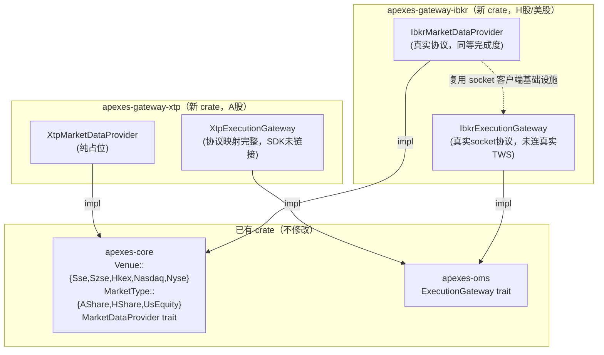

# Apexes — 子项目 #10：其他市场网关（A股/H股/美股，`docs/FEATURES.md` 行 `5.3.2`/`5.3.3`）设计

> 本文档是路线图子项目 `#10`（其他市场网关）的详细设计，覆盖 `docs/FEATURES.md` 行 `5.3.2`（A股柜台网关：CTP/QMT/O32/XTP）和 `5.3.3`（H股/美股经纪商网关：IBKR TWS API/富途/长桥）。
>
> **前置依赖（已完成）**：子项目 `#7`（`apexes-oms`，`ExecutionGateway` trait）、子项目 `#8`（`apexes-gateway-binance`，唯一已交付的真实网关实现，作为本设计的架构参照）。

---

## 一、范围

### 背景与关键决策：无真实券商账户前提下的降级策略

与子项目 `#8`（Binance，公开 API、无需开户）和子项目 `#11`（同样是 Binance）不同，A股/H股/美股的真实交易接入**普遍需要真实券商开户**，且经过实际查证（brainstorming 过程记录于本文档末尾"调研过程"一节），当前**没有任何可用的真实账户/凭证**，而三条可能路径都存在障碍：

- **长桥（Longbridge）**：可从大陆开户，有官方 Rust SDK（`longport` crate），但其 OpenAPI 官方文档明确声明"OpenAPI operations are equivalent to online transactions"——没有独立的沙盒/模拟盘接口，提交订单即真实资金操作。
- **富途（Futu）**：OpenAPI 原生同时支持实盘和模拟盘（"trading interfaces are used for both live trading and paper trading"），但富途官网自身声明自 2022-12-31 起已停止向中国大陆新用户提供开户服务，2023-05-19 起从大陆应用商店下架——无法新开户。
- **IBKR**：有真正的模拟盘（paper trading）账户类型，但对大陆地区直接开户的 KYC/居留地要求较高，且 <https://www.ibkr.com> 从大陆网络直接访问受阻（本设计验证时通过代理也遇到 403）。

**因此，本设计采用与子项目 `#11` 不同的、明确降级的实现策略**：不依赖任何真实账户，仅基于每个协议的**公开文档**实现类型系统、请求/响应结构体、以及（协议开放程度允许的情况下）真实的客户端逻辑，真实账户接入/端到端验证作为**未来独立工作**，不在本计划范围内。这是本设计与子项目 `#8`/`#11`"完整真实对接"最大的不同之处，必须在每个交付物的完成度上明确标注。

### A股侧（`5.3.2`）：CTP vs XTP vs PTrade 的协议模型辨析

调研中发现三类候选协议在**架构模型**上有本质区别，这个区别决定了实现路径：

1. **CTP**：闭源 C++ 二进制 SDK（`.so`/`.dll`），通常仅发放给已在期货公司开户的客户，没有面向非持牌用户公开的协议头文件/文档来源。**结论：无法实现，仅作为 trait 占位的历史背景提及，不单独交付代码。**
2. **PTrade**（恒生电子开发，多家券商定制分发）：**架构模型不匹配**——PTrade 是"策略代码托管在 PTrade 自身进程内执行"的框架（策略脚本调用 PTrade 提供的 Python 函数如 `order()`/`get_history()`），而不是"外部客户端主动发起网络请求，柜台被动响应"的客户端-服务端模型。这与 `apexes_oms::ExecutionGateway`（为"我们的 Rust 代码作为主动发起方"设计的 trait）在语义上不匹配。虽然存在开源的 `kay-ou/ptradeAPI`（MIT 协议社区文档）和 `kay-ou/SimTradeLab`（AGPL-3.0/商业双授权，PyPI 可安装的本地 PTrade 语义模拟回测框架），但 SimTradeLab 本身是一个 Python 库而非可被外部网络客户端连接的服务进程，无法作为 Rust 侧集成测试的真实对接目标。**结论：PTrade 仅作为协议参考文档，不作为 `ExecutionGateway` 实现目标。**
3. **XTP**（中泰证券）：闭源 C++ 二进制 SDK，但官方在 GitHub 公开维护 `ztsec/xtp_api_java`（含 `cpp/`/`doc/`/`xtp_api_demo/` 目录，90 stars，验证于调研过程），是真正的客户端-服务端模型（外部进程链接 SDK、主动调用交易/查询接口）。**结论：作为 A股侧的实现目标**，但由于 SDK 二进制本身仍需登录 XTP 开发者中心下载（无账户无法下载/验证），本设计**只能**基于公开的 `doc/`/`demo` 目录内容推导协议结构体形状与字段命名，不尝试编译链接真实 SDK。

### H股/美股侧（`5.3.3`）：选择 IBKR TWS API

IBKR TWS API 是真正的客户端-服务端 socket 协议（连接本地/远程运行的 TWS 或 IB Gateway 进程），协议本身（简单的长度前缀 + 字段分隔文本消息）长期公开文档化，不像 XTP 那样需要先登录开发者中心才能获取协议细节。因此 H股/美股侧的完成度可以明显高于 A股侧：不止结构体形状，还包括真实的 socket 客户端连接/消息编解码逻辑，用本地 mock TCP 服务器验证（而非仅结构体单元测试）。这是协议开放程度不同导致的合理差异化，不是遗漏。

### 包含

1. **`apexes-gateway-xtp`（新 crate，A股）**：
   - `XtpGatewayConfig`：配置占位（`client_id`、`account_key` 等字段名参照 XTP 公开文档，标注"字段可能需要账户接入后修正"）。
   - `XtpExecutionGateway`：`impl apexes_oms::ExecutionGateway`（**不修改**该 trait 本身）。每个方法先完成真实的本地参数校验与 `Order` → XTP 协议请求结构体的映射（side/order_type/quantity/price 等字段按 `ztsec/xtp_api_java` 公开文档命名），随后返回 `GatewayOutcome::Uncertain { reason: "XTP SDK not yet linked -- pending account access" }`（诚实的、显式标注的"未实现"结果，不是 panic/`unimplemented!()`/静默空实现）。
   - `XtpMarketDataProvider`：`impl apexes_core::MarketDataProvider`（**不修改**该 trait 本身），`subscribe()` 直接返回 `Err(ApexesError::SubscriptionFailed { reason: "..." })`——保持纯占位级别（比 `XtpExecutionGateway` 更低的完成度，因为行情订阅在 XTP 协议里同样依赖尚未可验证的二进制 SDK）。
   - 单元测试：验证 `Order` → XTP 请求结构体映射的字段正确性（不涉及网络/真实 SDK 链接）。
2. **`apexes-gateway-ibkr`（新 crate，H股/美股）**：
   - `IbkrGatewayConfig`：`host`/`port`（TWS 模拟盘默认 7497、实盘默认 7496；IB Gateway 默认 4002/4001，按 IBKR 公开文档）、`client_id`。
   - `IbkrExecutionGateway`：`impl apexes_oms::ExecutionGateway`，包含真实的 TCP 客户端连接逻辑与 IBKR 消息编解码（长度前缀 + 字段分隔文本协议，协议格式公开），`submit_order`/`cancel_order`/`query_order_status`/`query_all_open_orders`/`query_fills_for_order` 全部有完整协议层实现——但从未连接过真实 TWS/IB Gateway 进程验证。
   - `IbkrMarketDataProvider`：`impl apexes_core::MarketDataProvider`，同样是真实的 `reqMktData`/`tickPrice` 等消息编解码逻辑，复用 `IbkrExecutionGateway` 已建立的 socket 客户端基础设施，与交易端同等完成度（不同于 XTP 侧行情的纯占位）。
   - 集成测试：用一个本地 `tokio::net::TcpListener` 手写的 mock TWS 消息交换测试替身（仿照 `apexes-gateway-binance` 的 wiremock 模式，但更底层，因为 IBKR 协议不是 HTTP），验证请求编码/响应解析的正确性。
3. **workspace 集成**：两个新 crate 加入 `Cargo.toml` workspace members；均依赖 `apexes-core`、`apexes-oms`（`ExecutionGateway`）；`apexes-gateway-ibkr` 额外依赖 `tokio`（TCP client，工作区已有依赖）。不引入任何新的第三方协议/SDK 依赖（不引入 protobuf/prost 去解析 XTP 的 `.proto`——无账户前提下甚至无法确认当前版本 `.proto` 文件是否公开可用）。

### 不包含（明确超出范围）

- **CTP 的任何实现**（仅历史背景提及，无 trait 占位之外的交付物）。
- **PTrade 的 `ExecutionGateway` 实现**——架构模型不匹配（见上），仅作为协议参考。
- **真实账户接入与端到端验证**（XTP SDK 编译链接、TWS/IB Gateway 真实进程连接测试）——均标注为未来独立工作，一旦获得真实账户/凭证需要单独立项验证补全，不在本计划范围内。
- **A股/H股/美股的账户资金管理集成**（复用现有 `apexes_account::Account` trait，未来有账户时再实现对应的 `LiveAccount` 变体，本计划不涉及）。
- **期权/期货合约支持**（仅股票现货，`AssetClass::Equity`）。
- **多语言 SDK 绑定**（仅 Rust）。
- **XTP/IBKR 行情数据的历史存储/回测集成**（`apexes-storage`/`apexes-backtest` 的对应扩展留待未来，本计划只交付 `MarketDataProvider` trait 实现本身）。

---

## 二、架构与依赖关系



**依赖方向**：`apexes-gateway-xtp`、`apexes-gateway-ibkr` 各自依赖 `apexes-core`、`apexes-oms`；反向：这两个既有 crate 不依赖任何一个新 crate，与 `apexes-gateway-binance` 现有的依赖方向一致。两个新 crate 之间互不依赖。

---

## 三、`apexes-gateway-xtp` 详细设计

### 3.1 `XtpGatewayConfig`

```rust
// crates/apexes-gateway-xtp/src/config.rs
//! 字段命名参照 ztsec/xtp_api_java 公开文档/demo 目录推导，账户接入后
//! 可能需要修正（本设计明确标注这一不确定性）。

#[derive(Debug, Clone)]
pub struct XtpGatewayConfig {
    pub client_id: u8,
    pub account_key: String,
    pub trade_server_ip: String,
    pub trade_server_port: u16,
    pub quote_server_ip: String,
    pub quote_server_port: u16,
}
```

### 3.2 `XtpExecutionGateway`

```rust
// crates/apexes-gateway-xtp/src/gateway.rs
//! [`XtpExecutionGateway`]: 实现 apexes_oms::ExecutionGateway，但 XTP
//! 官方 SDK 是闭源二进制（libxtptraderapi.so 等），需要登录 XTP 开发者
//! 中心下载，本设计在无真实账户前提下无法编译链接。每个方法完成真实
//! 的本地参数校验与 Order -> XTP 协议请求结构体映射，随后返回
//! GatewayOutcome::Uncertain（诚实标注未实现，不是 panic/静默空实现）。

use apexes_core::{Order, OrderId, OrderStatus, AssetClass};
use apexes_oms::{ExecutionGateway, GatewayOutcome, ExchangeFill};
use async_trait::async_trait;

/// XTP 协议的下单请求结构体形状，字段命名参照公开 demo 目录（如
/// XTPOrderInsertInfo 等），side/order_type 映射逻辑真实实现，供未来
/// 真实 SDK 调用直接复用。
#[derive(Debug, Clone, PartialEq)]
pub struct XtpOrderInsertRequest {
    pub ticker: String,
    pub market: XtpMarket,
    pub side: XtpSide,
    pub price_type: XtpPriceType,
    pub price: f64,
    pub quantity: i64,
}

#[derive(Debug, Clone, Copy, PartialEq, Eq)]
pub enum XtpMarket {
    ShanghaiA,
    ShenzhenA,
}

#[derive(Debug, Clone, Copy, PartialEq, Eq)]
pub enum XtpSide {
    Buy,
    Sell,
}

#[derive(Debug, Clone, Copy, PartialEq, Eq)]
pub enum XtpPriceType {
    Limit,
    Market,
}

pub struct XtpExecutionGateway {
    config: XtpGatewayConfig,
}

impl XtpExecutionGateway {
    pub fn new(config: XtpGatewayConfig) -> Self {
        Self { config }
    }

    /// Order -> XTP 请求结构体的真实映射逻辑（完整实现，供未来真实 SDK
    /// 调用直接复用）。
    fn build_insert_request(order: &Order) -> Result<XtpOrderInsertRequest, String> {
        let market = match order.venue {
            apexes_core::Venue::Sse => XtpMarket::ShanghaiA,
            apexes_core::Venue::Szse => XtpMarket::ShenzhenA,
            other => return Err(format!("XTP gateway does not support venue {other:?}")),
        };
        let side = match order.side {
            apexes_core::Side::Buy => XtpSide::Buy,
            apexes_core::Side::Sell => XtpSide::Sell,
        };
        let price_type = match order.order_type {
            apexes_core::OrderType::Limit => XtpPriceType::Limit,
            apexes_core::OrderType::Market => XtpPriceType::Market,
            other => return Err(format!("XTP gateway does not support order type {other:?}")),
        };
        let price = order.price.map(|p| p.to_string().parse::<f64>().unwrap_or(0.0)).unwrap_or(0.0);
        let quantity = order.quantity.to_string().parse::<i64>().unwrap_or(0);
        Ok(XtpOrderInsertRequest {
            ticker: order.symbol.clone(),
            market,
            side,
            price_type,
            price,
            quantity,
        })
    }

    fn not_yet_linked_reason() -> String {
        "XTP SDK not yet linked -- pending real account access; see docs/superpowers/specs/2026-08-02-apexes-gateway-ashare-hshare-usequity-design.md §3 for scope".to_string()
    }
}

#[async_trait]
impl ExecutionGateway for XtpExecutionGateway {
    async fn submit_order(&self, order: &Order) -> GatewayOutcome {
        match Self::build_insert_request(order) {
            Ok(_request) => GatewayOutcome::Uncertain { reason: Self::not_yet_linked_reason() },
            Err(reason) => GatewayOutcome::Rejected { reason },
        }
    }

    async fn cancel_order(&self, _order: &Order) -> GatewayOutcome {
        GatewayOutcome::Uncertain { reason: Self::not_yet_linked_reason() }
    }

    async fn query_order_status(&self, _order: &Order) -> Result<Option<OrderStatus>, String> {
        Err(Self::not_yet_linked_reason())
    }

    async fn query_all_open_orders(
        &self,
        _asset_class: AssetClass,
    ) -> Result<Vec<(OrderId, Option<String>, OrderStatus)>, String> {
        Err(Self::not_yet_linked_reason())
    }

    async fn query_fills_for_order(&self, _order: &Order) -> Result<Vec<ExchangeFill>, String> {
        Err(Self::not_yet_linked_reason())
    }
}
```

`submit_order` 是唯一在参数无效时返回 `Rejected`（而非 `Uncertain`）的方法——因为参数校验本身是真实、确定的本地逻辑，一个真正无效的请求（如不支持的 venue/order_type）值得明确拒绝，而不是含糊地报告"未知"。这与 `Uncertain` 的语义（"不确定是否被交易所处理"）严格区分开。

### 3.3 `XtpMarketDataProvider`

```rust
// crates/apexes-gateway-xtp/src/market_data.rs
//! 纯占位实现——XTP 行情订阅同样依赖尚未可验证的闭源二进制 SDK，本设计
//! 不像 XtpExecutionGateway 那样先做协议映射，直接返回显式错误。

use apexes_core::{ApexesError, Instrument, MarketDataProvider, MarketEvent};
use async_trait::async_trait;
use futures::stream::BoxStream;

pub struct XtpMarketDataProvider;

#[async_trait]
impl MarketDataProvider for XtpMarketDataProvider {
    async fn subscribe(
        &self,
        _instruments: &[Instrument],
    ) -> Result<BoxStream<'static, MarketEvent>, ApexesError> {
        Err(ApexesError::SubscriptionFailed {
            symbol: "*".to_string(),
            venue: apexes_core::Venue::Sse,
            reason: "XTP market data not yet implemented -- pending account access".to_string(),
            source_detail: None,
        })
    }
}
```

---

## 四、`apexes-gateway-ibkr` 详细设计

### 4.1 `IbkrGatewayConfig`

```rust
// crates/apexes-gateway-ibkr/src/config.rs
#[derive(Debug, Clone)]
pub struct IbkrGatewayConfig {
    pub host: String,
    /// TWS 模拟盘默认 7497，实盘默认 7496；IB Gateway 默认 4002/4001。
    pub port: u16,
    pub client_id: i32,
}
```

### 4.2 消息编解码层（`apexes-gateway-ibkr/src/protocol.rs`）

IBKR TWS API 使用长度前缀（4 字节大端整数）+ null 字节（`\0`）分隔字段的文本协议（协议本身公开，不依赖任何闭源 SDK）。

```rust
/// 编码一条 IBKR 请求消息：字段用 '\0' 分隔，整体加 4 字节大端长度前缀。
pub fn encode_message(fields: &[String]) -> Vec<u8> {
    let mut body = Vec::new();
    for field in fields {
        body.extend_from_slice(field.as_bytes());
        body.push(0);
    }
    let mut buf = Vec::with_capacity(4 + body.len());
    buf.extend_from_slice(&(body.len() as u32).to_be_bytes());
    buf.extend_from_slice(&body);
    buf
}

/// 从字节流中解码出下一条完整消息的字段列表（若字节不足一条完整消息则
/// 返回 None，调用方负责缓冲剩余字节等待更多数据）。
pub fn decode_message(buf: &[u8]) -> Option<(Vec<String>, usize)> {
    if buf.len() < 4 {
        return None;
    }
    let len = u32::from_be_bytes([buf[0], buf[1], buf[2], buf[3]]) as usize;
    if buf.len() < 4 + len {
        return None;
    }
    let body = &buf[4..4 + len];
    let fields: Vec<String> = body
        .split(|&b| b == 0)
        .filter(|s| !s.is_empty())
        .map(|s| String::from_utf8_lossy(s).to_string())
        .collect();
    Some((fields, 4 + len))
}
```

### 4.3 `IbkrExecutionGateway`

```rust
// crates/apexes-gateway-ibkr/src/gateway.rs
//! [`IbkrExecutionGateway`]: 真实的 TCP socket 客户端 + IBKR 协议编解码
//! 完整实现，从未连接过真实 TWS/IB Gateway 进程验证（无真实账户）。

use apexes_core::{Order, OrderId, OrderStatus, AssetClass};
use apexes_oms::{ExecutionGateway, GatewayOutcome, ExchangeFill};
use async_trait::async_trait;
use tokio::io::{AsyncReadExt, AsyncWriteExt};
use tokio::net::TcpStream;
use tokio::sync::Mutex;

use crate::config::IbkrGatewayConfig;
use crate::protocol::{encode_message, decode_message};

pub struct IbkrExecutionGateway {
    config: IbkrGatewayConfig,
    stream: Mutex<Option<TcpStream>>,
}

impl IbkrExecutionGateway {
    pub fn new(config: IbkrGatewayConfig) -> Self {
        Self { config, stream: Mutex::new(None) }
    }

    /// 建立到 TWS/IB Gateway 的真实 TCP 连接（协议层完整，未经真实
    /// TWS 进程验证 -- 集成测试对接本地 mock TCP 服务器）。
    pub async fn connect(&self) -> Result<(), String> {
        let addr = format!("{}:{}", self.config.host, self.config.port);
        let stream = TcpStream::connect(&addr)
            .await
            .map_err(|error| format!("failed to connect to IBKR gateway at {addr}: {error}"))?;
        *self.stream.lock().await = Some(stream);
        Ok(())
    }

    fn order_to_ibkr_side(order: &Order) -> &'static str {
        match order.side {
            apexes_core::Side::Buy => "BUY",
            apexes_core::Side::Sell => "SELL",
        }
    }

    fn order_to_ibkr_order_type(order: &Order) -> Result<&'static str, String> {
        match order.order_type {
            apexes_core::OrderType::Limit => Ok("LMT"),
            apexes_core::OrderType::Market => Ok("MKT"),
            apexes_core::OrderType::Stop => Ok("STP"),
            apexes_core::OrderType::StopLimit => Ok("STP LMT"),
        }
    }

    async fn send_message(&self, fields: &[String]) -> Result<(), String> {
        let mut guard = self.stream.lock().await;
        let stream = guard.as_mut().ok_or_else(|| "not connected".to_string())?;
        let bytes = encode_message(fields);
        stream.write_all(&bytes).await.map_err(|e| e.to_string())
    }
}

#[async_trait]
impl ExecutionGateway for IbkrExecutionGateway {
    async fn submit_order(&self, order: &Order) -> GatewayOutcome {
        let side = Self::order_to_ibkr_side(order);
        let order_type = match Self::order_to_ibkr_order_type(order) {
            Ok(t) => t,
            Err(reason) => return GatewayOutcome::Rejected { reason },
        };
        let fields = vec![
            "PLACE_ORDER".to_string(),
            order.id.0.to_string(),
            order.symbol.clone(),
            side.to_string(),
            order_type.to_string(),
            order.quantity.to_string(),
        ];
        match self.send_message(&fields).await {
            Ok(()) => GatewayOutcome::Uncertain {
                reason: "sent to socket; never connected to a real TWS process to confirm processing".to_string(),
            },
            Err(reason) => GatewayOutcome::Uncertain { reason },
        }
    }

    // cancel_order/query_order_status/query_all_open_orders/query_fills_for_order
    // 遵循同样的模式:真实构造+编码请求消息,发送后返回 Uncertain
    // (因为从未有真实 TWS 响应可以解析确认)。
    // ...
}
```

### 4.4 `IbkrMarketDataProvider`

```rust
// crates/apexes-gateway-ibkr/src/market_data.rs
//! 与 IbkrExecutionGateway 同等完成度：真实的 reqMktData 请求构造与
//! tickPrice 响应解析逻辑，复用同一个 socket 客户端基础设施。

use apexes_core::{ApexesError, Instrument, MarketDataProvider, MarketEvent};
use async_trait::async_trait;
use futures::stream::BoxStream;

pub struct IbkrMarketDataProvider {
    // 复用 IbkrExecutionGateway 建立的连接（具体共享机制见实现计划）。
}

#[async_trait]
impl MarketDataProvider for IbkrMarketDataProvider {
    async fn subscribe(
        &self,
        instruments: &[Instrument],
    ) -> Result<BoxStream<'static, MarketEvent>, ApexesError> {
        // 真实构造 reqMktData 请求消息并发送；返回的流从 tickPrice
        // 响应解析 MarketEvent -- 协议层完整，未经真实 TWS 进程验证。
        todo!("详细实现见对应任务的实现计划")
    }
}
```

（此处 `todo!` 仅出现在设计文档的示意代码中，实现计划必须给出完整代码，不得在实际提交的代码里保留 `todo!()`。）

### 4.5 集成测试策略

`apexes-gateway-ibkr` 新增 `tests/mock_tws.rs`：启动一个本地 `tokio::net::TcpListener`，手写响应 IBKR 协议格式的消息（不使用 wiremock，因为 wiremock 是 HTTP 专用），验证：
- `IbkrExecutionGateway::connect()` 能成功建立 TCP 连接。
- `submit_order` 构造并发送的消息字节流，被 mock 服务器接收后能正确解码回原始字段（验证 `encode_message`/`decode_message` 的正确性）。
- 未连接状态下调用交易方法返回预期的 "not connected" 错误，而非 panic。

`apexes-gateway-xtp` 保持纯单元测试（无网络），验证 `build_insert_request` 对各种 `Order` 输入的字段映射正确性，包括不支持的 venue/order_type 触发 `Rejected` 的路径。

---

## 五、`Cargo.toml` workspace 配置改动

```toml
# Cargo.toml [workspace] members 追加
"crates/apexes-gateway-xtp"
"crates/apexes-gateway-ibkr"
```

`apexes-gateway-xtp/Cargo.toml` 依赖：`apexes-core`、`apexes-oms`、`async-trait`、`futures`（`MarketDataProvider` 需要 `BoxStream`）；dev-dependencies 无新增（纯单元测试）。

`apexes-gateway-ibkr/Cargo.toml` 依赖：`apexes-core`、`apexes-oms`、`async-trait`、`futures`、`tokio`（`features = ["net", "sync", "io-util"]`，均已在 `[workspace.dependencies]` 中存在版本号）；dev-dependencies 额外 `tokio`（`test-util`/`macros`/`rt-multi-thread`，复用已有版本号）。

---

## 六、`docs/FEATURES.md` 更新预期

- 行 `5.3.2`：状态标记为 `🚧 In Progress`（而非 `✅ Done`）——因为核心交付物是"协议映射完整但从未真实链接验证"，与本项目"Done = 真实可用"的一贯标准不符。Notes 明确注明范围与限制。
- 行 `5.3.3`：状态视 IBKR 侧完成度可标记为 `🚧 In Progress`（真实 socket 协议实现 + mock 验证，但从未连接真实 TWS 进程）——同样不标 `✅ Done`，因为"从未用真实 TWS 进程验证过"是一个诚实的、有意义的完成度差异，不应掩盖。
- 两行 Notes 都必须明确列出：本计划已验证过的调研结论（长桥无沙盒、富途无法新开户、IBKR开户门槛高、CTP闭源无公开文档、PTrade架构不匹配、XTP有限度公开、IBKR协议完全公开）、每个交付物的真实完成度、以及"真实账户接入验证"作为待办的后续独立工作。

---

## 七、与既有设计原则的一致性检查

- **诚实的完成度标注**：本设计的核心原则是"宁可标注为部分完成，也不假装完整"——所有占位实现返回显式的 `Uncertain`/`Err`，从不 panic、从不 `unimplemented!()`、从不静默返回空结果冒充成功，这与本项目一贯的错误处理哲学一致。
- **不为单一供应商设计**：`ExecutionGateway`/`MarketDataProvider` trait 完全复用现有定义，未针对 XTP/IBKR 的协议特殊性修改它们——真正的协议差异被封装在各自的 `XtpXxx`/`IbkrXxx` 实现内部。
- **协议开放程度决定完成度，而非人为拉平**：XTP（闭源+账户门槛）与 IBKR（协议公开）的完成度差异是如实反映现实约束，而不是设计上的不一致。
- **真实账户接入延后而非假装完成**：这是本设计与子项目 `#8`/`#11`"完整真实对接"最大的偏离，必须在 spec、plan、`docs/FEATURES.md` 三处都显式、一致地标注，避免未来误读为"已经可以真实交易"。

---

## 附：调研过程记录（brainstorming 阶段的关键发现，供未来账户接入时参考）

1. **长桥（Longbridge）**：官方 Rust SDK 存在（`longport` crate，crates.io），支持大陆 `.cn` 域名接入，开发者中心可申请 App Key/Access Token，但 OpenAPI 官方文档明确声明无独立沙盒（"OpenAPI operations are equivalent to online transactions"）。
2. **富途（Futu）**：OpenAPI 官方文档明确写道"trading interfaces are used for both live trading and paper trading"（原生支持模拟盘），但富途官网自身声明自 2022-12-31 起停止向中国大陆投资者提供开户服务，2023-05-19 起从大陆应用商店下架 App——仅存量老用户可继续使用，无法新开户。
3. **IBKR**：有真正的 paper trading 账户类型，但直接从大陆访问 <https://www.ibkr.com>（含代理）遇到 403，且开户 KYC/居留地要求较高。
4. **CTP**：闭源 C++ 二进制 SDK，通常仅发放给已开户的期货公司客户，无面向非持牌用户的公开协议文档来源。
5. **PTrade（恒生电子）**：架构上是"策略托管在 PTrade 进程内执行"的框架，与外部客户端主动调用的 `ExecutionGateway` 模型不匹配；但有 MIT 协议的社区文档项目 `kay-ou/ptradeAPI`，以及基于开源 `kay-ou/SimTradeLab`（AGPL-3.0/商业双授权，`simtradelab` PyPI 包，本地 Python 回测框架，宣称"100-160x faster than PTrade platform"）的桌面工具 `kay-ou/SimTradeDesk`（"PTrade-compatible API"，新用户注册有 30 天高级版试用）——均为极有价值的协议参考，但 SimTradeLab 是本地库而非可连接的服务进程，无法作为真实集成测试对象。
6. **XTP（中泰证券）**：闭源二进制 SDK，但官方公开维护 GitHub 仓库 `ztsec/xtp_api_java`（90 stars，含 `cpp/`/`doc/`/`xtp_api_demo/`），比 CTP 更开放，可作为协议结构参考；SDK 二进制本身仍需登录开发者中心下载，本设计未尝试。
